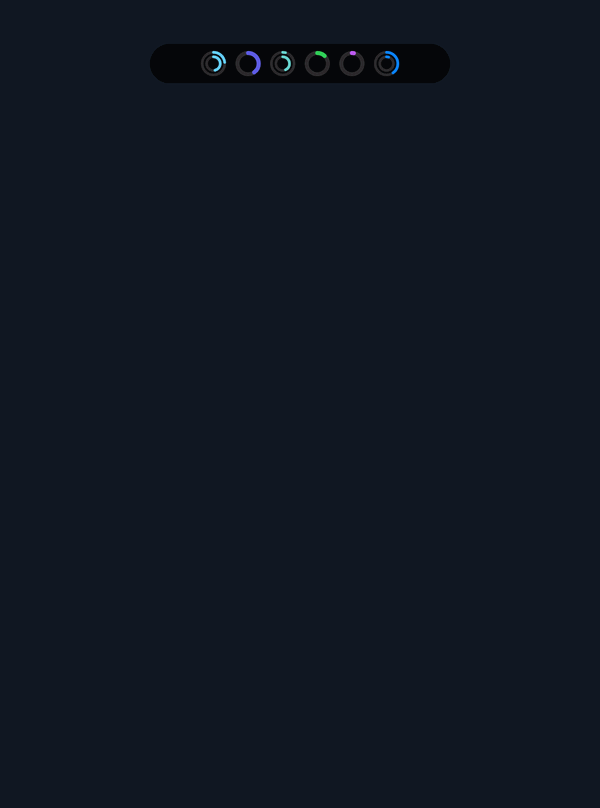
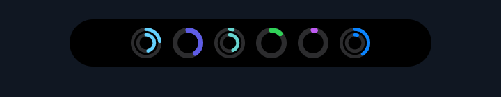
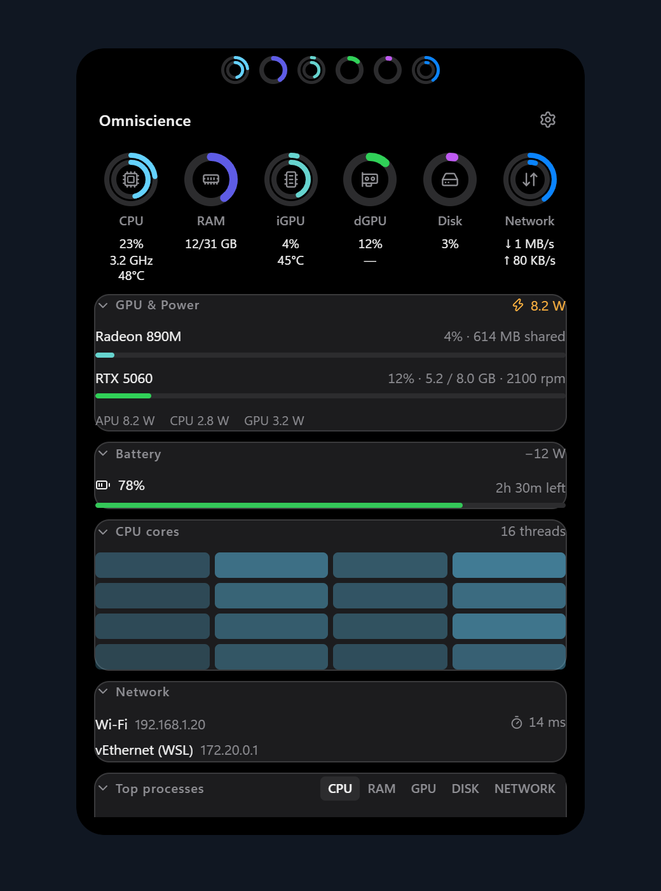
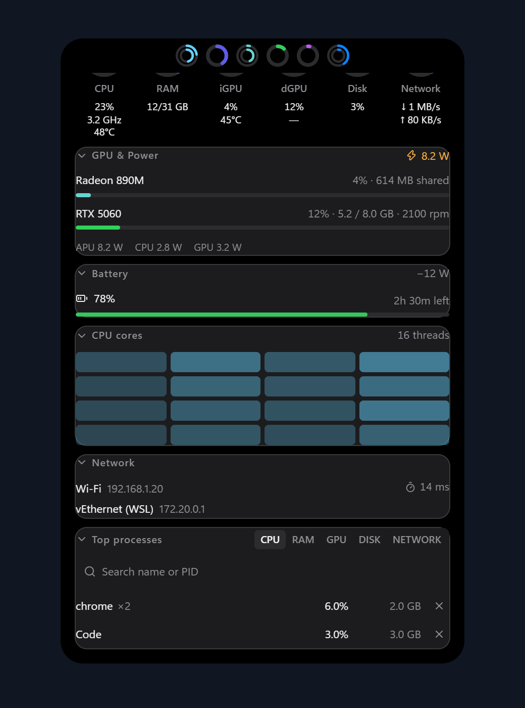
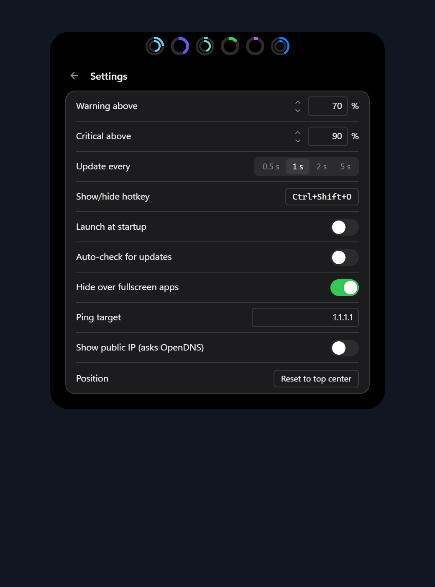

<p align="center"></p>

<p align="center">
  <a href="https://github.com/joezhuo2/omniscience/releases/latest"></a>
  <a href="https://github.com/joezhuo2/omniscience/releases"></a>
  <a href="https://github.com/joezhuo2/omniscience/actions/workflows/ci.yml"></a>
  
  
  <a href="https://v2.tauri.app"></a>
  <a href="https://react.dev"></a>
  <a href="LICENSE"></a>
</p>

<p align="center">
  <a href="#installation">Download</a> •
  <a href="#features">Features</a> •
  <a href="#screenshots">Screenshots</a> •
  <a href="#usage">Usage</a> •
  <a href="#configuration">Settings</a> •
  <a href="#platform-support">Platforms</a> •
  <a href="#privacy-and-permissions">Privacy</a> •
  <a href="#development">Development</a> •
  <a href="#contributing">Contributing</a> •
  <a href="#license">License</a>
</p>

> A lightweight, open-source system monitor built with Tauri 2, Rust and React.
> Omniscience floats above your desktop as a Dynamic Island–style pill, with rings
> for CPU, RAM, GPU, disk and network activity. Hover to open a compact dashboard
> with per-core usage, GPU power and temperature, battery life and top processes.
> It lives in the tray, with no taskbar button or Alt+Tab entry.

<p align="center"></p>

<p align="center"><em>Current interface with sample telemetry. Sensor availability varies by hardware and platform.</em></p>

## Features

### The pill

- 💊 A black, Dynamic Island–style pill pinned to the top-center of your screen.
- ⭕ Six live rings with icons and no text: **CPU**, **RAM**, **iGPU**, **dGPU**, **Disk** (active
  time), and a concentric **Network** ring with download outside and upload inside.
- 🌡️ CPU, iGPU and dGPU have inner temperature rings: a full ring is **105°C**. Missing
  temperatures hide the inner ring. Temperature colors use the configured warning/critical
  percentages of that scale (defaults: above 73.5°C / 94.5°C).
- 🚦 Rings are colored by load: the metric's own accent color normally, amber above the warning
  threshold (default 70%), and pulsing red above the critical threshold (default 90%).
- ➖ A ring is drawn dashed when its sensor is missing on your machine, instead of showing a fake 0%.

### The dashboard

Hover the pill and it expands in place with a 280 ms clip-path morph. It opens the moment the cursor
arrives and collapses the moment it leaves; coming back mid-collapse reverses it. Press **Esc** to
close it.

- ⚡ **Header:** a Settings shortcut and an amber indicator if telemetry stops arriving. Package
  watts live in GPU & Power; CPU temperature sits below the CPU ring.
- 📊 **Metric strip:** labeled values for each ring, such as CPU usage with its live clock in GHz,
  RAM as `15/31 GB`, and download/upload speeds on two lines. CPU temperature appears on a third
  line; each GPU temperature appears on a second line. Missing temperatures show `—`. The CPU
  tooltip identifies the hottest ACPI thermal zone as a system-temperature proxy, which may
  differ from CPU package temperature.
- 🎮 **GPU & Power card:** usage, VRAM (`5.2 / 8.0 GB`) and fan speed for each GPU, a
  Throttling chip when a GPU reaches its thermal limit, and package watts broken down into APU, CPU,
  GPU and NPU where the hardware reports them.
- 🔋 **Battery card** (laptops): charge, charging or draining with the rate in watts, and time left or
  time to full, read from the battery driver. On supported ASUS laptops a draggable bar sets the maximum charge
  (20-100%), saved and reapplied at launch. A skeleton appears while battery data loads; the card hides on machines without a battery.
- 🔥 **CPU heatmap:** one cell per logical core. Hover a cell for its usage, clock, per-core watts and
  the package temperature. A performance-limit chip reports lost CPU performance headroom from
  Windows power policy or platform limits; it does not directly measure thermal throttling.
- 🌐 **Network card:** each active adapter with its IPv4 address, with ping latency on the first row to a
  host you choose (1.1.1.1 by default), and optionally your public IP.
- 📋 **Top processes:** grouped by app (so 30 browser processes show as one row), sortable by CPU,
  RAM, GPU, Disk or Network. The GPU tab shows each app's GPU usage and GPU memory; Disk and
  Network show bytes per second when Windows per-app telemetry is available. Three rows by default, with
  "Show more" for a scrollable list. Search by app name or PID; skeletons appear while the search updates.
- 🛑 **End process:** a two-step "End?" button. Critical OS processes, PIDs 0 and 4, and Omniscience
  itself are refused; the row comes back with a toast explaining why.

- ↕️ **Arrange cards:** drag a card to reorder it, or focus it and use Space/Enter, arrow keys,
  then Space/Enter to drop (Esc cancels). Click a section heading to minimize or expand its details.
  Order and minimized state are remembered across restarts; reduced-motion preferences are respected.

Detailed per-core, GPU memory and per-process data is only sampled while the dashboard is open.
Temperature readings also update while collapsed; sleeping discrete GPUs are not queried.

### System configuration

The dashboard has **Info** and **Config** tabs. Info contains monitoring; Config contains
a **Driver & software updates** card. Choose **Check now** to query Windows Update,
including optional drivers and Microsoft software. Offered updates have a **Download**
button that opens their Microsoft Update Catalog entry. Checks continue in the background when
the dashboard closes; reopening Config shows progress or the finished results. The tray's
**Check for system updates** action starts the same check and opens the card. Other third-party
apps are not checked.
On supported ASUS ROG laptops, Config also offers **GPU mode**: Auto switches between
iGPU-only on battery and hybrid graphics when plugged in; Med, Min and Max select hybrid,
iGPU-only and dGPU display modes. MUX changes require a Windows restart.
See [System configuration](docs/configuration.md) for coverage and usage.

### Lives in the tray

- 🫥 No taskbar button and no Alt+Tab entry. Everything else is in the tray menu: **Show / Hide**,
  **Launch at startup**, **Auto-check for updates**, **Hide over fullscreen apps**, **Check for
  updates now**, **Check for system updates**, **Settings…**, and **Quit**.
- ⌨️ A global show/hide hotkey, `Ctrl+Shift+O` by default (`Cmd+Shift+O` on macOS).
- 🖐️ Drag the pill (the row of rings) to move the overlay. It snaps to nearby screen edges and the
  top-center, never stays partly off-screen, and its spot is remembered per monitor layout and per
  monitor. Near the bottom of a screen, the dashboard opens upward far enough to fit.
- 🎬 Hides automatically while a fullscreen game, video or presentation covers its monitor, and comes
  back when it ends. Telemetry pauses while hidden.
- 1️⃣ Launching it a second time reveals the running copy instead of starting another.

### No extra software

- 🔓 Core monitoring needs no admin rights, kernel drivers, or third-party tools such as HWiNFO
  or LibreHardwareMonitor. Optional per-app Disk and Network rates use Windows ETW and may require
  administrator rights; unavailable readings display an em dash.
- 🧩 On Windows, sensors come from built-in performance counters, the Energy Meter counters and
  D3DKMT. NVIDIA's NVML is not used, so a sleeping laptop dGPU is never woken just to be measured.
- ❔ Missing sensors show `--`.

### Updates

With auto-check on, Omniscience checks GitHub Releases at launch. When a new version is out, the
island opens with "vX available. Update? Yes / No". **Yes** downloads, installs and restarts.
Updates are signature-checked before they are installed.

## Installation

Download the latest build from the
[Releases page](https://github.com/joezhuo2/omniscience/releases/latest).

### Windows 10/11

1. Download either installer:
   - `Omniscience_x.y.z_x64-setup.exe` (NSIS, per-user, recommended), or
   - `Omniscience_x.y.z_x64_en-US.msi` (MSI, for managed installs).
2. Run it. Builds are not code-signed yet, so SmartScreen may warn about an unrecognized app. Click
   **More info**, then **Run anyway**.
3. Omniscience starts at the top of your primary monitor and adds an icon to the tray. If the icon
   is hidden, open the tray overflow (the `^` arrow) and drag it onto the taskbar to keep it
   visible.

WebView2 is required and ships with Windows 11. On Windows 10 the installer downloads it if it is
missing.

### macOS (experimental)

1. Download `Omniscience_x.y.z_universal.dmg`. It runs natively on Apple silicon and Intel Macs.
2. Open the dmg and drag **Omniscience** to **Applications**.
3. Builds are not signed or notarized yet, so Gatekeeper blocks the first launch. Right-click the
   app, choose **Open**, then **Open** again. If macOS says the app is damaged, clear the
   quarantine flag:

   ```bash
   xattr -dr com.apple.quarantine /Applications/Omniscience.app
   ```

See [Platform support](#platform-support) for what works on macOS.

### Build from source

Prerequisites:

- 🟢 [Node.js 24+](https://nodejs.org)
- 🦀 [Rust (stable)](https://rustup.rs)
- 🛠️ The [Tauri prerequisites](https://v2.tauri.app/start/prerequisites/) for your OS: the MSVC build
  tools on Windows, or the Xcode command-line tools on macOS.

```bash
git clone https://github.com/joezhuo2/omniscience.git
cd omniscience
npm install
npm run tauri build
```

Installers end up in `src-tauri/target/release/bundle/`. To build only the executable, run
`npm run tauri build -- --no-bundle`.

### Uninstalling

- 🪟 **Windows:** Settings > Apps > Installed apps > Omniscience > Uninstall.
- 🍎 **macOS:** quit from the tray, then move `Omniscience.app` to the Trash.

Settings are kept after uninstalling. Delete the [settings file](#configuration) to remove them.

## Usage

| Action                   | How                                                            |
| ------------------------ | -------------------------------------------------------------- |
| Open the dashboard       | Move the cursor onto the pill                                  |
| Close the dashboard      | Move the cursor away, or press **Esc**                         |
| Show or hide the overlay | `Ctrl+Shift+O` (`Cmd+Shift+O` on macOS), or tray > Show / Hide |
| Move the overlay         | Drag the pill (the row of rings)                               |
| Reset its position       | Settings > Reset position                                      |
| Sort processes           | Click CPU / RAM / GPU / Disk / Network on Top processes        |
| Search processes         | Type an app name or PID in the Top processes search bar        |
| End an app               | Click **End?** on its row, then confirm                        |
| Open settings            | Gear icon in the dashboard header, or tray > Settings…         |
| Check for updates        | Tray > Check for updates now                                   |
| Quit                     | Tray > Quit                                                    |

Clicks pass through the transparent area around the pill to whatever is underneath, so the overlay
never blocks the window behind it.

## Screenshots

Captured from the current React interface using sample telemetry, with private addresses and
example app names. These illustrate the UI rather than measurements from a particular machine.

<p align="center"></p>

| Dashboard — overview                                                                                                                                                                                                        | Dashboard — lower sections                                                                                                                                                                                                                             |
| --------------------------------------------------------------------------------------------------------------------------------------------------------------------------------------------------------------------------- | ------------------------------------------------------------------------------------------------------------------------------------------------------------------------------------------------------------------------------------------------------ |
| <br>**Overview** — metric rings, GPU & Power, Battery and CPU cores. | <br>**Lower sections** — CPU cores, Network and Top processes. |

<p align="center"><br><em>Settings — thresholds, hotkey, privacy controls and position reset.</em></p>

[Media details](docs/assets/README.md)

## Configuration

Open **Settings** from the gear icon in the dashboard header or from the tray.

| Setting                | Default        | Notes                                                       |
| ---------------------- | -------------- | ----------------------------------------------------------- |
| Warning threshold      | 70%            | Rings turn amber above this                                 |
| Critical threshold     | 90%            | Rings turn red and pulse above this                         |
| Update interval        | 1 s            | 0.5 to 5 s. Longer intervals use less CPU                   |
| Show/hide hotkey       | `Ctrl+Shift+O` | Click the recorder and press a new combination              |
| Launch at startup      | Off            | Also in the tray menu; mirrors the OS login items           |
| Auto-check for updates | On             | Checks GitHub Releases once at launch                       |
| Hide over fullscreen   | On             | Hides while a fullscreen app covers the overlay's monitor   |
| Ping target            | `1.1.1.1`      | Pinged every 2 s while the dashboard is open; empty is off  |
| Show public IP         | Off            | One DNS query to OpenDNS every 10 min while open            |
| Reset position         | —              | Moves the overlay back to the top-center of the primary one |

Settings are saved as JSON in the app config folder:

- 🪟 **Windows:** `%APPDATA%\io.github.joezhuo2.omniscience\settings.json`
- 🍎 **macOS:** `~/Library/Application Support/io.github.joezhuo2.omniscience/settings.json`

Missing keys fall back to their defaults and out-of-range values are clamped, so a hand-edited or
older file still loads.

## Platform support

| Platform      | Status                                                                 |
| ------------- | ---------------------------------------------------------------------- |
| Windows 10/11 | Primary, tested                                                        |
| macOS         | Experimental. Builds in CI but is untested, and some sensors show `--` |

Sensor coverage depends on the hardware and drivers:

| Sensor                     | Windows                                 | macOS   |
| -------------------------- | --------------------------------------- | ------- |
| CPU, RAM, disk, network    | Yes                                     | Yes     |
| Per-core usage and clock   | Yes                                     | Yes     |
| GPU usage and VRAM         | Yes, per GPU (D3DKMT)                   | `--`    |
| GPU temperature            | Where the driver reports it             | `--`    |
| Package and per-core watts | Where Energy Meter counters are exposed | `--`    |
| Temperatures               | ACPI thermal zones, GPU driver          | `--`    |
| Hide over fullscreen apps  | Yes                                     | Not yet |

On Windows, power readings are most complete on recent AMD and Intel laptops, which expose Energy
Meter counters. Desktop CPUs often do not, and show `--`.

## Performance

The budget is at most **50 MB** of RAM across the whole process tree and below **0.1% CPU** while
collapsed and idle. To get there, the WebView runs with software compositing and a low memory
target, detail sampling only runs while the dashboard is open, and telemetry pauses entirely while
the overlay is hidden.

In v0.1.0 the collapsed pill averages under 50 MB and about 0.1% CPU on a quiet machine, rising to
about 0.25% while load swings a lot, because each larger ring change animates. Measured numbers, the method, and the
reference machine are in [docs/perf.md](docs/perf.md).

## Privacy and permissions

- 🏠 Omniscience reads system counters locally. It sends no telemetry, analytics or crash reports.
- 🌐 Network use is limited to the update check against this repository's GitHub Releases, an ICMP
  ping to the ping target while the dashboard is open, and, only if you turn on **Show public IP**,
  one DNS query to OpenDNS every ten minutes. Turn off **Auto-check for updates** and clear the ping
  target to stop all of it.
- 🛡️ Core monitoring runs without admin rights. Windows per-app Disk and Network rates use a
  private ETW session while the dashboard is visible and expanded, and may require administrator
  rights. Ending a process that belongs to another user or an elevated app fails with an
  "access denied" toast rather than prompting for elevation.

## Troubleshooting

**The overlay disappeared.** Press the hotkey or use tray > Show / Hide. If **Hide over
fullscreen apps** is on, it also hides while a fullscreen window covers its monitor, including some
borderless games and video players.

**The overlay is off-screen after unplugging a monitor.** Positions are saved per monitor layout and
per monitor, and are always pulled fully on screen when restored, but if it still looks wrong, use
Settings > Reset position.

**A ring is dashed or a value shows `--`.** That sensor is not available on your hardware or
platform. See [Platform support](#platform-support).

**The hotkey does nothing.** Another app may have registered the same combination. Pick a different
one in Settings.

**"Update failed" when installing an update.** The update did not pass signature verification. Download the latest
installer from the [Releases page](https://github.com/joezhuo2/omniscience/releases) instead.

**Something else is wrong.** [Open an issue](https://github.com/joezhuo2/omniscience/issues) with
your OS version, CPU and GPU models, and what you expected to happen.

## Development

Install the [build-from-source prerequisites](#build-from-source), then:

```bash
npm install
npm run tauri dev
```

The overlay has no taskbar button. Use the tray icon to show, hide, or quit it.

| Command                                           | What it does                                                   |
| ------------------------------------------------- | -------------------------------------------------------------- |
| `npm run tauri dev`                               | Run the app with hot reload                                    |
| `npm test`                                        | Frontend unit tests (Vitest)                                   |
| `cargo test --manifest-path src-tauri/Cargo.toml` | Rust unit tests                                                |
| `npm run lint` / `npm run format`                 | ESLint / Prettier                                              |
| `npm run typecheck`                               | TypeScript type check                                          |
| `npm run tauri build`                             | Release build and installers                                   |
| `cargo test` (as above)                           | Also regenerates the TypeScript types in `src/types/generated` |

CI runs lint, format check, tests, `cargo clippy -D warnings` and a release build on both Windows and
macOS for every push and pull request.

### Project layout

```text
src/                    React frontend
  components/           Pill, rings, update banner
  components/dashboard/ Expanded dashboard cards
  components/settings/  Settings view
  types/generated/      TypeScript types generated from Rust (do not edit)
src-tauri/src/          Rust backend
  telemetry/            Sampler thread, Windows counters, process list
  shell.rs, tray.rs     Tray menu, hotkey, fullscreen auto-hide
  settings.rs           Persisted settings
  positions.rs          Saved positions, edge snapping, dashboard lift
scripts/                Performance measurement and window-style probes
docs/                   Performance log, test checklist, release guide, design spec
```

### Tech stack

[Tauri 2](https://v2.tauri.app), Rust, React 19, TypeScript, Tailwind CSS v4, Zustand, and
[Lucide](https://lucide.dev) icons. Theme and morph animation follow
[islet](https://github.com/joezhuo2/islet).

### Further reading

- 📐 [Design spec](docs/superpowers/specs/2026-10-10-omniscience-design.md)
- ✅ [Manual test checklist](docs/testing.md)
- ⏱️ [Performance log](docs/perf.md)
- 📝 [Changelog](CHANGELOG.md)

## Releasing

Pushing a `v*` tag builds the Windows installers and a universal macOS dmg, signs the updater
artifacts, and drafts a GitHub Release with `latest.json`. One-time updater key setup and the full
checklist are in [docs/releasing.md](docs/releasing.md).

## Contributing

Issues and pull requests are welcome.

1. Fork the repository and create a branch from `main`.
2. Make your change, with tests where it makes sense.
3. Run `npm run lint`, `npm run format:check`, `npm test` and
   `cargo clippy --manifest-path src-tauri/Cargo.toml --all-targets -- -D warnings`.
4. Add a line under **Unreleased** in [CHANGELOG.md](CHANGELOG.md).
5. Open a pull request describing what changed and how you tested it.

If you have a Mac, testing the experimental macOS build and reporting what works is especially
helpful.

## Acknowledgements

- 🏝️ [islet](https://github.com/joezhuo2/islet) for the pill design, theme and morph animation.
- 🙏 [Tauri](https://tauri.app), [sysinfo](https://github.com/GuillaumeGomez/sysinfo) and
  [Lucide](https://lucide.dev).

## License

[MIT](LICENSE) © Omniscience contributors
